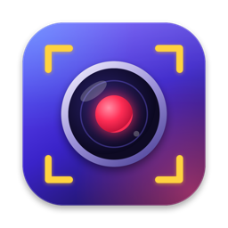

<p align="center">
  
</p>

<h1 align="center">SmartDemo</h1>

<p align="center">
  Record product demos that look edited, without editing.<br>
  Native macOS screen recorder with cinematic zoom, cursor effects and a face cam you direct live with shortcuts.
</p>

<p align="center">
  <a href="https://github.com/Ismailhachimi/smartdemo/actions/workflows/build.yml"></a>
  
  
  <a href="LICENSE"></a>
</p>

---

SmartDemo is a menu-bar app for recording demos and personalized sales videos. Everything happens
**while you record**: zoom on what matters, enlarge the cursor, move your camera bubble to a corner,
or bring it to the center as a large rectangle to talk straight to your audience. Then shrink it
back. Each change is animated with springs, so the video comes out ready to send.

Recordings stay on your Mac as standard MP4 files (H.264 + AAC).

## Features

**Capture**
- Full screen, a single window, a whole application, or a custom zone you draw.
- Microphone audio, with pause / resume.
- 1080p, 1440p or native 4K, at 30 or 60 fps.

**Camera bubble**
- Circle, rounded square or 16:9 rectangle, in three sizes.
- Snaps to any corner. You can also drag it with the mouse.
- **Presenter mode**: the camera grows into a centered 16:9 frame over a blurred background.

**Zoom and cursor**
- Zoom that follows the mouse, ×1.5 to ×3, with a smooth dead zone.
- Optional auto-zoom on every click.
- Big cursor, click ripples, cursor halo, and a spotlight that dims everything around the pointer.
- Optional styled frame: margins, gradient background, rounded corners and shadow.

**While recording**
- Global shortcuts that work on any keyboard layout (AZERTY included).
- On-screen viewfinder showing the zoomed area, and a live preview window of the actual output.
- A clickable shortcut guide that shows which effects are on.
- SmartDemo's own windows (bubble, guide, preview, toasts) are never captured.

## Requirements

- macOS 14 Sonoma or later (Apple silicon or Intel)
- Xcode 15.4+ or the Swift 5.10+ command-line tools

## Install from source

```bash
git clone https://github.com/Ismailhachimi/smartdemo.git
cd smartdemo
./scripts/create-signing-cert.sh   # once, optional but recommended (see below)
./build.sh --install               # builds and copies SmartDemo.app to ~/Applications
open ~/Applications/SmartDemo.app
```

On first launch, allow **Screen & System Audio Recording**, **Camera** and **Microphone**
in *System Settings → Privacy & Security*, then quit and reopen SmartDemo.

### Why a local signing certificate?

macOS ties these permissions to the app's code signature. An ad-hoc signed build gets a new
signature each time you rebuild, so macOS forgets the permissions. `scripts/create-signing-cert.sh`
creates a self-signed identity in your login keychain, and `build.sh` uses it automatically, so
the permissions stay granted. The certificate works for local builds only. It cannot be used to
distribute the app.

To sign with another identity, run `SMARTDEMO_SIGN_IDENTITY="Your identity" ./build.sh`.

## Keyboard shortcuts

All shortcuts use **⌃⌥** (Control + Option).

| Keys | Action | |
|---|---|---|
| ⌃⌥R | Start / stop recording | |
| ⌃⌥P | Pause / resume | recording only |
| ⌃⌥G | Shortcut guide | |
| ⌃⌥E | Live preview of the output | recording only |
| ⌃⌥Z | Zoom that follows the mouse | recording only |
| ⌃⌥X | Next zoom level (×1.5 → ×3) | |
| ⌃⌥A | Auto-zoom on clicks | recording only |
| ⌃⌥M | Big cursor | recording only |
| ⌃⌥H | Cursor halo | |
| ⌃⌥L | Spotlight around the cursor | recording only |
| ⌃⌥W | Show / hide the camera | |
| ⌃⌥V | Presenter mode | |
| ⌃⌥S | Bubble size | |
| ⌃⌥O | Bubble shape | |
| ⌃⌥1 – 4 | Bubble to a corner ↖ ↗ ↙ ↘ | |

Videos are saved to `~/Movies/SmartDemo`.

> The interface is in French for now. English localization is on the roadmap.

## How it works

```
ScreenCaptureKit ─┐
Camera (AVCapture) ┼─► Director (120 Hz springs) ─► Compositor (Core Image / Metal) ─► AVAssetWriter → MP4
Microphone ───────┘          ▲                                                    └─► live preview
                     global shortcuts, mouse
```

| File | Role |
|---|---|
| [`Director.swift`](Sources/SmartDemo/Director.swift) | Live state and spring animations: cursor, zoom, camera layout. |
| [`Compositor.swift`](Sources/SmartDemo/Compositor.swift) | Builds every frame on the GPU: spotlight, cursor effects, styled frame, zoom, presenter blur, camera. |
| [`Recorder.swift`](Sources/SmartDemo/Recorder.swift) | Fixed-fps render loop, H.264/AAC encoding, pause, audio timing, live preview buffers. |
| [`Capture.swift`](Sources/SmartDemo/Capture.swift) | Sources (display, window, app, zone), camera and microphone devices. |
| [`Overlays.swift`](Sources/SmartDemo/Overlays.swift) | On-screen bubble, zone picker, countdown, toasts. None of them are recorded. |
| [`Panels.swift`](Sources/SmartDemo/Panels.swift) | Zoom viewfinder, live preview window, shortcut guide. |
| [`Hotkeys.swift`](Sources/SmartDemo/Hotkeys.swift) | Global shortcuts (Carbon), resolved against the current keyboard layout. |
| [`main.swift`](Sources/SmartDemo/main.swift) | Menu-bar app, menu, recording lifecycle. |

### Self-test

Render test frames of every effect, without any capture permission:

```bash
build/SmartDemo.app/Contents/MacOS/SmartDemo --selftest selftest
```

CI runs this on every push.

## Roadmap

- English localization
- Optional upload with share links, access control and viewer analytics (self-hostable)
- Scriptable recordings for personalized demos at scale

## Contributing

Issues and pull requests are welcome. See [CONTRIBUTING.md](CONTRIBUTING.md).

## License

[MIT](LICENSE) © Ismail Hachimi
